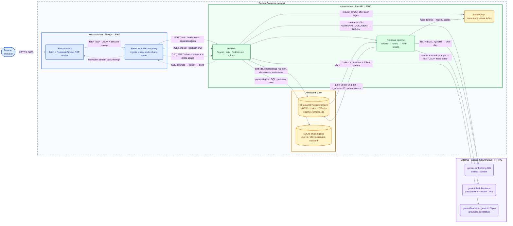
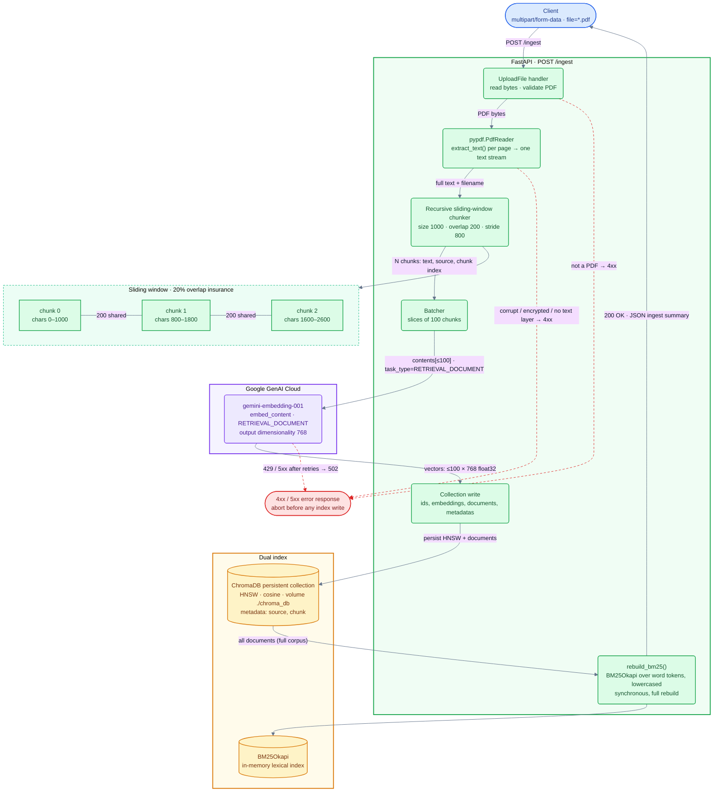
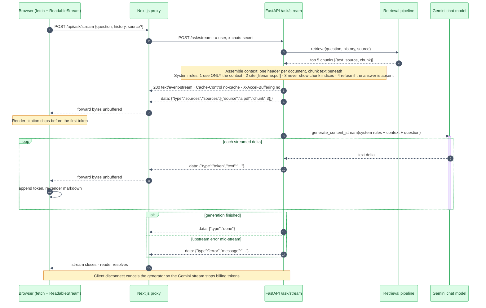
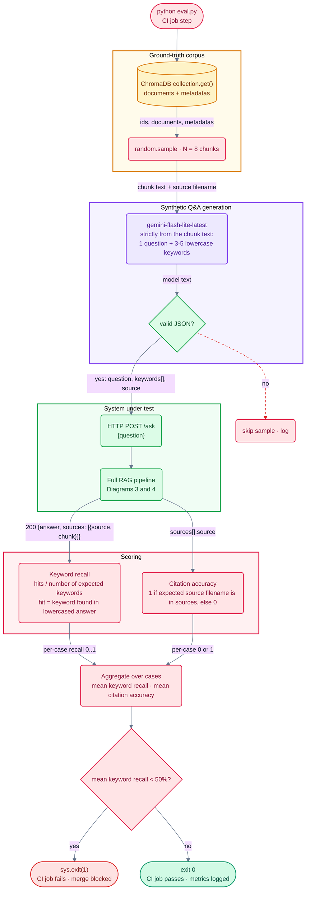
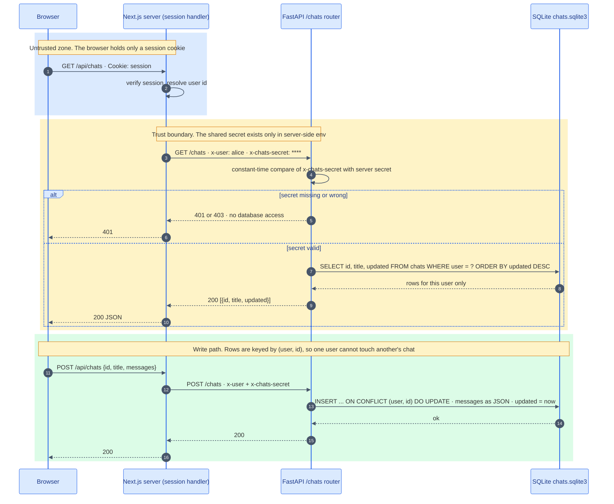

# RAG Document Q&A Engine: Architecture Diagrams

Six diagrams for the engineering deep-dive. Zero LangChain: plain Python, FastAPI, ChromaDB and the Google GenAI SDK.
Paste any block into [mermaid.live](https://mermaid.live), GitHub Markdown, Notion, or your blog's Mermaid plugin.

**Colour legend (used in every diagram)**

| Colour | Meaning |
|---|---|
| Blue `#DBEAFE` | Frontend / client |
| Green `#DCFCE7` | FastAPI gateway and pipeline logic |
| Amber `#FEF3C7` | Stores (ChromaDB, BM25, SQLite) |
| Violet `#EDE9FE` | Gemini models |
| Rose `#FFE4E6` | Evaluation / CI |
| Red dashed edges | Fallback or failure paths |

**Constants and contracts referenced throughout**

| Name | Value |
|---|---|
| `CHUNK_SIZE` / `CHUNK_OVERLAP` / stride | 1000 / 200 / 800 characters |
| Embedding | `gemini-embedding-001`, Matryoshka-truncated to 768-dim, batch size 100 |
| Task types | `RETRIEVAL_DOCUMENT` at ingest, `RETRIEVAL_QUERY` at query time |
| `K_fuse` | 20 per retriever |
| RRF constant | 60 |
| `TOP_K` after rerank | 5 |
| Eval sample / gate | N = 8 chunks, fail if mean keyword recall < 50% |

```jsonc
// POST /ask  ->  200
{ "answer": "string", "sources": [ { "source": "file.pdf", "chunk": 7 } ] }

// POST /ask/stream  ->  text/event-stream, one JSON object per "data:" frame
data: {"type":"sources","sources":[{"source":"file.pdf","chunk":7}]}
data: {"type":"token","text":"..."}        // repeated
data: {"type":"done"}                       // or {"type":"error","message":"..."}
```

---

## Diagram 1: Complete System Architecture and Container Topology



### Technical deep dive

**Interactions and handshakes.** The browser never talks to FastAPI. Every call goes through the Next.js container, whose server-side session handler resolves the user and forwards the request with two trusted headers, `x-user` and `x-chats-secret`. The two containers are decoupled: `web` owns UI and session, `api` owns retrieval, state and every Gemini call, so API keys never reach the client bundle. The only stateful pieces are the `./chroma_db` volume (HNSW graph plus documents and metadata) and `chats.sqlite3`; the BM25 index is derived state held in the API process. Streaming responses flow back as `text/event-stream` and the proxy must pipe them through unbuffered.

**Failure modes and invariants.** Three external dependencies can fail independently: the Gemini API (429s, 5xx, timeouts), the Chroma volume (missing mount means an empty corpus after restart) and SQLite (file locking under concurrent writers). Each Gemini call site needs an explicit timeout and its own degradation rule: rewrite falls back to the raw question, rerank falls back to RRF order, embedding failure aborts the request with a 5xx, and a mid-stream generation failure is reported in-band as an `error` SSE event because HTTP headers are already sent. Because BM25 lives in memory, the invariant to enforce is that it is rebuilt from the Chroma corpus on API startup as well as after each ingest, otherwise dense and sparse indexes silently diverge after a restart.

**Production trade-offs.** Going without LangChain trades ready-made integrations for predictable latency: each request has a countable number of network hops (1 rewrite, 1 query embedding, 1 vector query, 1 rerank, 1 generation stream), each independently timed and loggable. Embedded Chroma plus SQLite keeps the deployment to two containers and one volume, which is the right size for a single-node service but caps horizontal scaling: two API replicas would each hold their own BM25 index and contend on the SQLite file. The path to scale is a server-mode vector store, a shared BM25 or sparse-vector index, and Postgres for chats; the diagram's boundaries already isolate those three swaps.

---

## Diagram 2: Dual-Index Ingestion Pipeline (Dense Vector + Sparse Lexical)



### Technical deep dive

**Interactions and handshakes.** `POST /ingest` receives a multipart PDF, `pypdf.PdfReader` walks every page and concatenates the extracted text, and the chunker slides a 1000-character window with a stride of 800, so adjacent chunks share 200 characters (about 20%). That overlap is insurance: a sentence cut at a boundary appears whole in at least one chunk, which keeps both the embedding and the BM25 tokens for that sentence intact. Chunks are embedded in batches of 100 with `task_type=RETRIEVAL_DOCUMENT`, truncated to 768 dimensions, then written to Chroma with `{"source": filename, "chunk": index}` metadata. Only after the dense write does `rebuild_bm25()` re-tokenize the whole corpus and replace the in-memory lexical index.

**Failure modes and invariants.** The pipeline has no useful partial state: a request that dies after three of ten embedding batches leaves a half-indexed document that retrieves inconsistently. The invariant to hold is embed every batch first, write to Chroma once, and use deterministic ids (for example filename plus chunk index) so a retried or re-uploaded file upserts instead of duplicating. Scanned PDFs return empty text from `pypdf` and should produce an explicit 4xx rather than a zero-chunk success. Embedding calls need bounded retries with backoff on 429 and 5xx; because the BM25 rebuild is synchronous, the request holds until both indexes agree, which gives read-your-writes consistency for the next `/ask`.

**Production trade-offs.** A character-based window is cheap, deterministic and easy to reason about, but it ignores document structure; headings, tables and code blocks can split mid-unit, which is where a structure-aware splitter earns its complexity. The full BM25 rebuild is O(corpus) per upload, which is negligible at thousands of chunks and becomes the bottleneck near hundreds of thousands, at which point an incremental or persisted sparse index is the fix. Truncating `gemini-embedding-001` to 768 dimensions cuts vector storage and HNSW memory by roughly 4x versus the 3072-dimension default at a small recall cost, and because Matryoshka-trained vectors concentrate information in leading dimensions, the truncation degrades gracefully; Chroma's cosine space normalizes at distance time.

---

## Diagram 3: Multi-Stage Hybrid Retrieval, RRF Fusion and LLM Reranking

```mermaid
%%{init: {"theme":"base","themeVariables":{"fontFamily":"Inter, Segoe UI, sans-serif","fontSize":"14px","lineColor":"#64748b","primaryTextColor":"#0f172a"},"flowchart":{"curve":"basis","htmlLabels":true}}}%%
flowchart TD
  q(["User question + chat history<br/>from POST /ask or /ask/stream"])

  subgraph S0["Stage 0 · Conversational query rewrite"]
    direction TB
    rw("rewrite_question()<br/>gemini-flash-lite-latest")
    raw("Raw question<br/>fallback")
  end

  fan{{"Parallel fan-out<br/>standalone query"}}

  subgraph S1["Stage 1 · Candidate generation (optimise recall)"]
    direction LR
    subgraph DENSE["Dense retriever"]
      direction TB
      de("embed_content<br/>RETRIEVAL_QUERY · 768-dim")
      dq[("ChromaDB HNSW<br/>cosine · n_results = 20<br/>optional where source")]
    end
    subgraph SPARSE["Sparse retriever"]
      direction TB
      st("Tokenize<br/>word tokens, lowercase")
      sb[("BM25Okapi.get_scores<br/>top 20 by score")]
    end
  end

  rrf("Reciprocal Rank Fusion<br/>RRF(d) = Σ over m of 1 / (60 + rank_m(d))<br/>m ∈ dense, sparse")

  subgraph S2["Stage 2 · Listwise rerank (optimise precision)"]
    direction TB
    rr("Cross-encoder style reranker<br/>gemini-flash-lite-latest<br/>one prompt: query + chunks [0]..[19]")
    parse{"JSON array parses?<br/>e.g. 0, 3, 7, 1, 12"}
  end

  top5("TOP_K = 5 chunks")
  ctx("Prompt context assembly<br/>one header per document + chunk text")
  out(["To Diagram 4<br/>grounded generation"])

  q -->|"question + prior turns"| rw
  rw -->|"standalone search query"| fan
  rw -.->|"LLM error or timeout"| raw
  raw -.->|"use raw query"| fan

  fan -->|"query"| de
  de -->|"query vector 768-dim"| dq
  fan -->|"query"| st
  st -->|"token list"| sb

  dq -->|"20 ranked ids (rank 1 = best)"| rrf
  sb -->|"20 ranked ids (rank 1 = best)"| rrf
  rrf -->|"union ≤ 40 → sort by RRF desc → keep top 20"| rr
  rr -->|"raw model text"| parse
  parse -->|"yes: dedupe, bounds-check, take 5"| top5
  parse -.->|"no: fall back to RRF order, first 5"| top5
  top5 -->|"5 × text + metadata source, chunk"| ctx
  ctx --> out

  classDef fe fill:#DBEAFE,stroke:#2563EB,stroke-width:1.5px,color:#1E3A8A
  classDef api fill:#DCFCE7,stroke:#16A34A,stroke-width:1.5px,color:#14532D
  classDef store fill:#FEF3C7,stroke:#D97706,stroke-width:1.5px,color:#78350F
  classDef llm fill:#EDE9FE,stroke:#7C3AED,stroke-width:1.5px,color:#4C1D95
  classDef bad fill:#FEE2E2,stroke:#DC2626,stroke-width:1.5px,color:#7F1D1D
  class q,out fe
  class fan,st,rrf,parse,top5,ctx api
  class dq,sb store
  class rw,de,rr llm
  class raw bad
  style S0 fill:#F5F3FF,stroke:#7C3AED,stroke-width:2px
  style S1 fill:#F8FAFC,stroke:#94A3B8,stroke-width:2px
  style DENSE fill:#FFFBEB,stroke:#D97706
  style SPARSE fill:#FFFBEB,stroke:#D97706
  style S2 fill:#F5F3FF,stroke:#7C3AED,stroke-width:2px
  linkStyle 2,3,13 stroke:#DC2626,stroke-dasharray: 5 4
```



### Technical deep dive

**Interactions and handshakes.** The rewriter turns a follow-up like "and the second one?" plus the chat history into a standalone query, so both retrievers receive a question that makes sense without context. Dense and sparse retrieval then run in parallel: the dense side embeds the query with `RETRIEVAL_QUERY` (the asymmetric partner of `RETRIEVAL_DOCUMENT`) and asks Chroma for the 20 nearest chunks; the sparse side tokenizes the query and takes the 20 best BM25 scores. RRF merges the two ranked lists, using only ranks, into at most 40 unique candidates and keeps the top 20. Those 20, numbered `[0]` to `[19]`, go to the reranker in a single prompt that must answer with a JSON array of the best five indices.

**Failure modes and invariants.** Every LLM stage has a deterministic exit: a rewrite error or timeout uses the raw question; a rerank that times out, returns prose, or emits out-of-range or duplicate indices falls back to RRF order truncated to `TOP_K = 5`. The invariants to enforce are that the rerank parser validates indices against `0 ≤ i < len(candidates)` and deduplicates, that fewer than 20 candidates is legal (small corpora), and that a `source` filter is applied on both sides: Chroma takes it natively through `where`, while BM25 has no filter, so scores of chunks from other documents must be masked or the fusion leaks other files into a filtered query. An empty corpus should short-circuit to the refusal path rather than call the reranker.

**Production trade-offs.** RRF beats score normalization here because cosine similarity (bounded, tightly clustered) and BM25 (unbounded, corpus-dependent) live on incomparable scales, and min-max or z-score normalization is brittle to a single outlier; rank-based fusion has one constant (60) and no tuning. Its behaviour is also desirable: a chunk ranked 1 in only one list scores 1/61 ≈ 0.0164, while a chunk ranked 20 in both scores 2/80 = 0.025, so agreement between retrievers outweighs a lone strong vote. Two stages beat single-pass KNN because HNSW is optimised for recall at low cost but cannot judge relevance to the question; a listwise LLM pass over 20 candidates costs one round trip instead of 20 pointwise calls, and shrinks the generation prompt to about 5,000 characters of context.

---

## Diagram 4: Grounded Answer Synthesis and SSE Streaming



### Technical deep dive

**Interactions and handshakes.** The streaming endpoint runs retrieval to completion first, then opens the `StreamingResponse` and emits events in a fixed order: one `sources` frame, a run of `token` frames, and exactly one terminal frame, `done` or `error`. Sending sources first lets the UI paint citations immediately and keeps them visible even if generation later fails. The prompt carries four hard rules: answer only from the supplied chunks, cite documents by `[filename.pdf]`, never expose internal chunk indices, and explicitly refuse when the context lacks the answer. The browser reads with `fetch` and a `ReadableStream` reader because `EventSource` cannot issue a POST with a body or custom headers; frames are separated by blank lines, so the client must buffer partial reads and split on `\n\n`.

**Failure modes and invariants.** Once the first byte is sent, the HTTP status is committed to 200, so mid-stream failures can only be reported in-band as `{"type":"error"}`; the client must treat a stream that ends without `done` or `error` as a failure (dropped connection, proxy timeout). Failures before the response opens, such as retrieval errors or a bad secret, should return a normal non-2xx JSON response. Intermediaries are the usual culprit for "it streams locally but not in production": the Next.js proxy must pass the body through without buffering, and reverse proxies need response buffering disabled, hence `X-Accel-Buffering: no`. The generator should stop when the client disconnects so abandoned requests do not keep consuming model tokens.

**Production trade-offs.** SSE is one-directional and rides ordinary HTTP, which suits token streaming better than WebSockets: it works through standard proxies and auth, and reconnection logic stays trivial because every request is a fresh question. The cost is that retry and resume are not free; a dropped stream restarts the whole answer. Delivering sources before tokens is a deliberate trust trade-off: users can verify provenance while the answer is still forming, at the price of showing citations for an answer the model may then refuse. Keeping `/ask` as a synchronous twin that returns `{answer, sources}` in one JSON body is valuable for the evaluation harness, which needs a complete answer to score.

---

## Diagram 5: Synthetic Evaluation Harness and CI Gating (`eval.py`)



### Technical deep dive

**Interactions and handshakes.** The harness needs no hand-labelled dataset. It samples N = 8 chunks from the live ChromaDB corpus and asks `gemini-flash-lite-latest` to write one factual question and three to five lowercase keywords grounded strictly in that chunk, so each case has a known source file and known answer terms by construction. Each question is posted to `/ask` against the real stack, exercising rewrite, hybrid retrieval, RRF, rerank and generation exactly as a user would. Scoring is two cheap deterministic checks: keyword recall (fraction of expected keywords appearing in the lowercased answer) and citation accuracy (whether the expected filename appears among the cited sources).

**Failure modes and invariants.** The main weakness of synthetic evaluation is circularity and noise: the question writer and the answerer are the same model family, questions can be answerable from many chunks, and a 8-sample estimate has wide variance (each sample moves the mean by 12.5 points). The gate therefore protects against regressions, not absolute quality. Invariants to hold: a failed generation or malformed JSON skips the case and is logged, but an HTTP error or timeout from `/ask` must count as a zero rather than being dropped, otherwise an outage can pass CI; if every sample is skipped the run must fail, not average an empty list; and the exit code, not the log text, is the contract with CI.

**Production trade-offs.** Keyword recall is a blunt, lexical proxy: it rewards answers that echo the chunk's vocabulary and cannot detect paraphrased correct answers or fluent wrong ones, which is why a lenient 50% floor is a smoke alarm rather than a quality bar. Its virtues are speed, zero extra model cost at scoring time and total determinism. To tighten it without losing those properties, increase N (or fix a seed for reproducible runs), add a retrieval-only metric (was the source chunk inside the final top 5?) to separate retriever regressions from generator regressions, and track the means over time so a slow slide below the threshold is visible before the gate trips.

---

## Diagram 6: Session Proxy, State Isolation and Shared-Secret Security Boundary



### Technical deep dive

**Interactions and handshakes.** The browser authenticates only to Next.js, using a session cookie. The server-side handler resolves that session to a user id, then calls FastAPI with `x-user` (who) and `x-chats-secret` (proof the caller is the trusted proxy). FastAPI validates the secret before touching the database and scopes every statement by `user`; the `chats` table stores `user, id, title, messages, updated` with `(user, id)` as the natural key, so identical chat ids from different users never collide. Because the secret is a server-only environment variable (never a `NEXT_PUBLIC_` one), it is absent from the browser bundle and from any network trace the user can see.

**Failure modes and invariants.** This design makes the proxy the sole identity authority: FastAPI believes `x-user` completely, so anyone who obtains the shared secret, or who can reach port 8000 directly, can impersonate any user. The invariants to hold are that the secret comparison is constant-time, that a missing secret configuration fails closed (refuse to start or reject everything, never skip the check), that the user value is always bound as a query parameter and never string-built into SQL, and that in production the API port is reachable only on the internal Docker network rather than published to the host. SQLite adds a concurrency limit: enable WAL mode and a busy timeout so concurrent chat saves queue instead of raising "database is locked".

**Production trade-offs.** A shared secret plus a trusted identity header is the simplest possible service-to-service trust model: no token issuance, no JWT validation in Python, and one place (the Next.js session layer) where login logic lives. The price is a single static credential with no per-request expiry and no cryptographic binding of `x-user` to the request. When the API outgrows one trusted caller, signing a short-lived token that contains the user id (HMAC or JWT) removes the impersonation risk without changing the proxy topology. Storing a chat's `messages` as one JSON column keeps reads and writes to a single row and is perfectly adequate here; queries across individual messages would be the reason to normalize.
