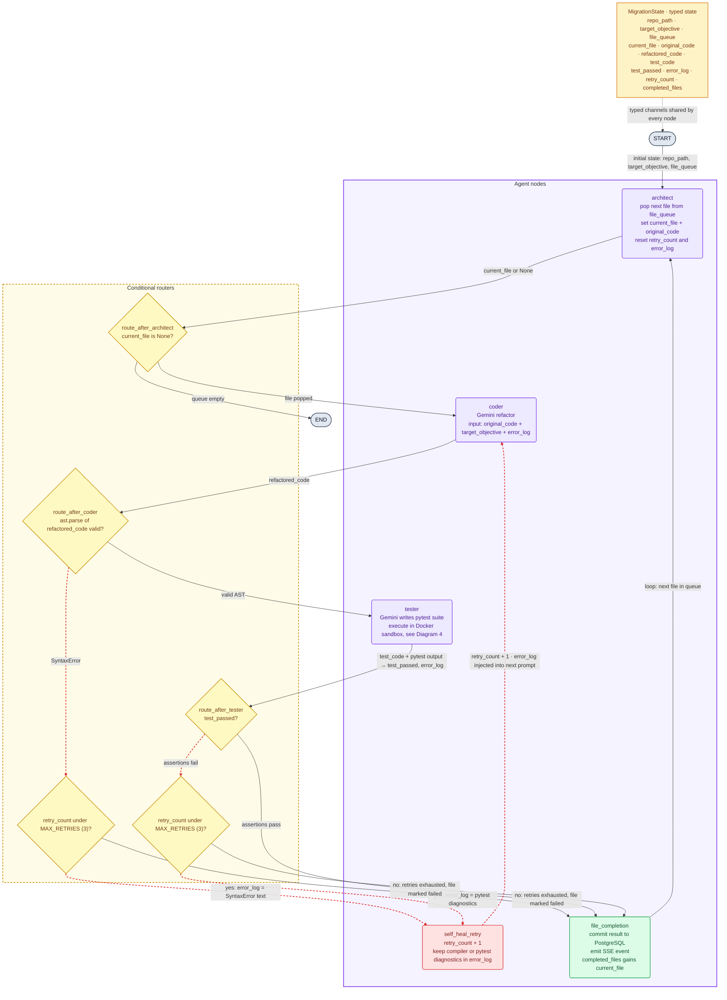
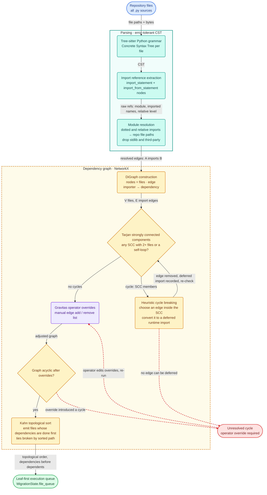
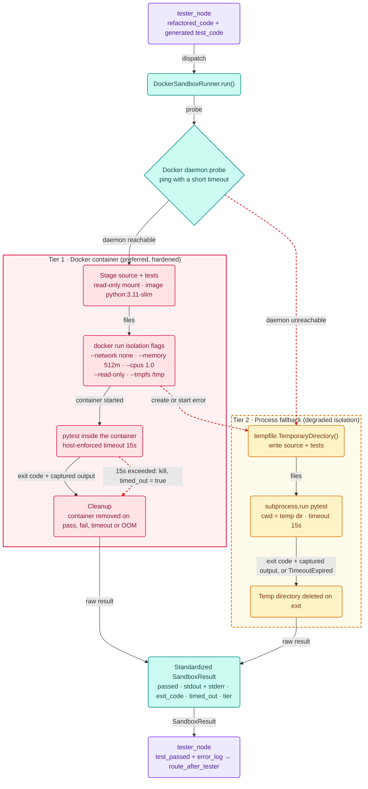
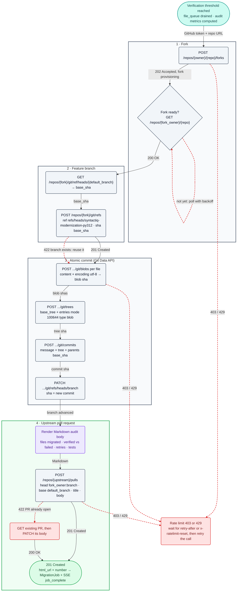
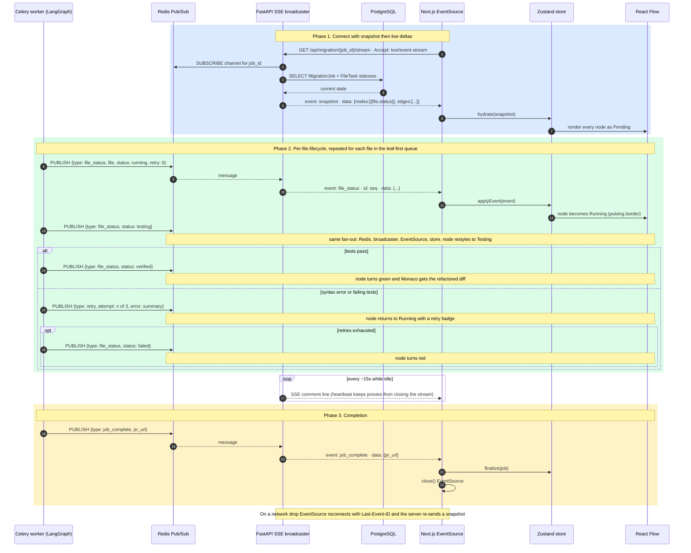

# Syntactiq: Architecture Diagrams

Six diagrams for the engineering deep-dive on Syntactiq, the autonomous multi-agent platform that refactors legacy code to Python 3.12+, synthesizes tests in sandboxes and opens GitHub pull requests.

## Colour legend (used in every diagram)

| Colour | Meaning |
|---|---|
| Blue `#DBEAFE` | Client (Next.js, browser) |
| Green `#DCFCE7` | API tier (FastAPI) |
| Orange `#FFEDD5` | Redis (broker, result store, Pub/Sub) |
| Teal `#CCFBF1` | Celery workers and analysis code |
| Violet `#EDE9FE` | Agents (LangGraph nodes) and LLM calls |
| Rose `#FFE4E6` | Sandboxes |
| Amber `#FEF3C7` | Databases and graph state |
| Slate `#F1F5F9` | External services (Gemini, GitHub) |
| Red dashed edges | Failure, retry, or fallback paths |

## `MigrationState`, the typed state shared by every LangGraph node

| Field | Type | Role |
|---|---|---|
| `repo_path` | `str` | Checked-out repository root |
| `target_objective` | `str` | Modernization goal injected into every coder prompt |
| `file_queue` | `List[str]` | Topologically sorted, leaf-first |
| `current_file` | `Optional[str]` | File being processed; `None` means the queue is drained |
| `original_code` / `refactored_code` / `test_code` | `Optional[str]` | Source, Gemini rewrite, generated pytest suite |
| `test_passed` | `bool` | Result of the sandbox run |
| `error_log` | `Optional[str]` | Compiler or pytest diagnostics fed back to the coder |
| `retry_count` | `int` | Self-heal attempts for the current file, `MAX_RETRIES = 3` |
| `completed_files` | `List[str]` | Files finished, verified or not |

---

## Diagram 1: Complete System Topology and Distributed Infrastructure

```mermaid
flowchart LR
  subgraph CLIENT["Client · Next.js 14 App Router (browser)"]
    direction TB
    zustand("Zustand store<br/>job, nodes, edges, diffs")
    rf("React Flow<br/>animated DAG telemetry")
    monaco("Monaco Editor<br/>AST diff view")
    es("EventSource<br/>text/event-stream")
  end

  subgraph API["API tier · FastAPI on Uvicorn (ASGI)"]
    direction TB
    rest("REST routes · Pydantic v2<br/>POST /api/migrations")
    sse("SSE broadcaster · EventSourceResponse<br/>GET /api/migration/{job_id}/stream")
  end

  subgraph BROKER["Redis 5.0"]
    direction TB
    queue[("Celery broker<br/>task queue")]
    result[("Result backend<br/>task state + return value")]
    pubsub[("Pub/Sub channels<br/>per-job telemetry")]
  end

  subgraph WORKERS["Celery 5.3.6 worker cluster"]
    direction TB
    job("run_migration task")
    analysis("Tree-sitter + NetworkX<br/>dependency DAG")
    egress("GitHub egress step")
  end

  subgraph AGENTS["Multi-agent core"]
    lg("LangGraph compiled StateGraph<br/>architect · coder · tester")
  end

  subgraph DB["PostgreSQL · SQLAlchemy ORM"]
    pg[("Repository · MigrationJob<br/>FileTask · AST metric tables")]
  end

  subgraph SBX["Sandbox host"]
    docker("Docker daemon<br/>ephemeral python:3.11-slim containers")
  end

  subgraph EXT["External egress · HTTPS"]
    gemini("Google Gemini API<br/>refactoring + test generation")
    github("GitHub REST API v3<br/>fork, branch, tree commit, PR")
  end

  zustand -->|"POST /api/migrations {repo_url, target_objective}"| rest
  rest -->|"202 Accepted {job_id}"| zustand
  es -->|"GET stream · Accept text/event-stream"| sse
  sse -.->|"event: file_status · data: JSON"| es
  es -->|"dispatch(event)"| zustand
  zustand -->|"node status + edges"| rf
  zustand -->|"original vs refactored code"| monaco

  rest -->|"INSERT Repository, MigrationJob status=PENDING"| pg
  rest -->|"send_task run_migration(job_id) · JSON message"| queue
  queue -->|"deliver task message"| job
  job -->|"scan repo_path"| analysis
  analysis -->|"file_queue, leaf-first"| lg
  job -->|"invoke graph with initial MigrationState"| lg
  lg -->|"generateContent: prompt + code + error_log"| gemini
  gemini -.->|"refactored code / pytest source"| lg
  lg -->|"Docker Engine API: create, start, wait, logs, remove"| docker
  docker -.->|"exit code + pytest output"| lg
  lg -->|"UPSERT FileTask + AST metrics"| pg
  lg -->|"PUBLISH {type, file, status}"| pubsub
  pubsub -->|"SUBSCRIBE job channel"| sse
  sse -->|"SELECT snapshot on connect"| pg
  job -->|"state SUCCESS or FAILURE"| result
  lg -->|"verified files + audit metrics"| egress
  egress -->|"fork, branch, blobs, tree, commit, pulls"| github

  classDef fe fill:#DBEAFE,stroke:#2563EB,stroke-width:1.5px,color:#1E3A8A
  classDef api fill:#DCFCE7,stroke:#16A34A,stroke-width:1.5px,color:#14532D
  classDef redis fill:#FFEDD5,stroke:#EA580C,stroke-width:1.5px,color:#7C2D12
  classDef worker fill:#CCFBF1,stroke:#0D9488,stroke-width:1.5px,color:#134E4A
  classDef agent fill:#EDE9FE,stroke:#7C3AED,stroke-width:1.5px,color:#4C1D95
  classDef sandbox fill:#FFE4E6,stroke:#E11D48,stroke-width:1.5px,color:#881337
  classDef db fill:#FEF3C7,stroke:#D97706,stroke-width:1.5px,color:#78350F
  classDef ext fill:#F1F5F9,stroke:#475569,stroke-width:1.5px,color:#0F172A
  class zustand,rf,monaco,es fe
  class rest,sse api
  class queue,result,pubsub redis
  class job,analysis,egress worker
  class lg agent
  class docker sandbox
  class pg db
  class gemini,github ext
  style CLIENT fill:#EFF6FF,stroke:#2563EB,stroke-width:2px
  style API fill:#F0FDF4,stroke:#16A34A,stroke-width:2px
  style BROKER fill:#FFF7ED,stroke:#EA580C,stroke-width:2px
  style WORKERS fill:#F0FDFA,stroke:#0D9488,stroke-width:2px
  style AGENTS fill:#F5F3FF,stroke:#7C3AED,stroke-width:2px,stroke-dasharray: 5 4
  style DB fill:#FFFBEB,stroke:#D97706,stroke-width:2px
  style SBX fill:#FFF1F2,stroke:#E11D48,stroke-width:2px,stroke-dasharray: 5 4
  style EXT fill:#F8FAFC,stroke:#475569,stroke-width:2px,stroke-dasharray: 6 4
```

### Technical deep dive

**Interactions and handshakes.** The request path is deliberately short. `POST /api/migrations` validates the body with Pydantic v2, inserts a `Repository` and a `MigrationJob` row, enqueues a Celery task through Redis and returns `202 Accepted {job_id}` without waiting for any LLM work. A worker picks the task up, builds the dependency DAG, and runs the compiled LangGraph over the leaf-first file queue, calling Gemini for refactors and tests, the Docker daemon for sandboxed pytest runs, and PostgreSQL for per-file persistence. Progress is a separate channel: the worker publishes small JSON events to a per-job Redis Pub/Sub channel, FastAPI's SSE broadcaster relays them, and the browser's `EventSource` feeds the Zustand store that drives React Flow and Monaco.

**Failure modes and invariants.** Four dependencies fail independently: Gemini (429s, 5xx, malformed output), the Docker daemon (down or out of capacity, which triggers the process fallback of Diagram 4), GitHub (rate limits, token scope) and the worker itself. For worker loss, run Celery with late acknowledgement so an interrupted task is redelivered, and treat the `FileTask` rows as checkpoints so a redelivered job skips files already finished instead of re-spending LLM calls. A closed browser tab must not cancel a job, because the SSE stream is only an observer. The invariant that makes this safe is that PostgreSQL is the source of truth for state and Redis Pub/Sub is only a live hint, since Pub/Sub messages are not stored for absent subscribers.

**Production trade-offs.** Celery plus Redis is more machinery than FastAPI background tasks, but migrations run for minutes and must survive API restarts, so a durable queue with a separate worker tier is the right shape. Using one Redis for broker, result store and Pub/Sub is the simplest deployment and the largest shared failure domain; enable persistence and watch memory, or split the roles when load grows. Processing files strictly in dependency order caps parallelism, but it is what lets each refactor see already-modernized dependencies, and Gemini rate limits would cap parallel fan-out anyway. Finally, a worker that can start containers holds near-root power on its host (Docker socket access); that is the single most important boundary to harden in production.

---

## Diagram 2: Compiled LangGraph StateGraph and Self-Healing Loop

### Technical deep dive

**Interactions and handshakes.** Every node reads and returns slices of the typed `MigrationState`, and LangGraph merges the returned keys into the shared state. `architect` pops the head of the leaf-first queue; the first router ends the run when `current_file` is `None`. `coder` receives the source, the `target_objective` and any prior `error_log`, so a retry prompt is the original task plus the exact diagnostic that sank the last attempt. `route_after_coder` runs a native `ast.parse` as a cheap gate, so a rewrite that is not even valid Python never reaches the sandbox. `route_after_tester` reads `test_passed`; either router sends failures to `self_heal_retry`, which increments `retry_count` and loops back, while success or exhaustion goes to `file_completion`, which persists the result, emits the SSE event and returns to `architect`.

**Failure modes and invariants.** The loop is bounded: with `MAX_RETRIES = 3`, the first attempt plus three heals means a file triggers at most four coder calls, and after the fourth failure it is routed to `file_completion` and recorded as failed rather than blocking the queue. Termination rests on two invariants: `architect` strictly shrinks `file_queue` on every pass, and `retry_count` and `error_log` are reset whenever a new file is popped, so one file's failures never throttle the next. Keep `error_log` to the latest diagnostic, truncated, rather than appending forever, so prompt size stays flat. One operational trap: LangGraph's default recursion limit is 25 steps, and one stubborn file alone can use about 13 node executions, so set the limit from the queue length, for example 15 times the number of files.

**Production trade-offs.** A graph with explicit routers costs more upfront than a `while` loop, but it makes control flow inspectable and gives natural hooks for telemetry: every edge is a place to emit an SSE event, and every router is a named, testable function. Working one file at a time with a fresh context keeps prompts small and failures local, at the price of no cross-file refactors in a single step. Three retries is a cost cap on a loop where later attempts have diminishing returns, and `error_log` acts as the learning signal between attempts. Because the sandbox verdict is the only ground truth, the real quality ceiling is the generated test suite: tests that are too weak make "verified" cheap, so audit metrics such as test counts belong in the final report.

---

## Diagram 3: AST Dependency Decomposition, Cycle-Breaking and Operator Overrides

### Technical deep dive

**Interactions and handshakes.** Tree-sitter parses each file into a Concrete Syntax Tree, and the extractor walks it for `import_statement` and `import_from_statement` nodes, recording module, imported names and relative level. A resolver maps those references to repository file paths and discards the standard library and third-party packages, since only intra-repo edges affect ordering. NetworkX holds the resulting `DiGraph` with edges pointing from importer to dependency. Tarjan's algorithm finds strongly connected components in linear time; any component with more than one file, or a self-loop, is a cycle. The heuristic breaker removes one edge from the cycle and records the import as deferred to runtime (moved into function scope), then the graph is re-checked until no cycles remain, at which point operator overrides are applied and Kahn's algorithm emits the queue.

**Failure modes and invariants.** Tree-sitter is error-tolerant, so legacy files that Python's own `ast` would reject outright (Python 2 `print` statements, for instance) still yield a tree with localized error nodes and their imports can still be extracted; `ast` is kept for validating the refactored output. Static analysis cannot see `importlib`, `__import__` or `exec`, so some real dependencies are invisible, and the overrides layer is the safety valve for them. The core invariant is that Kahn only runs on an acyclic graph: if the emitted order is shorter than the node count, a cycle survived and the run must stop, not process a partial queue. Overrides must be validated for new cycles, and ties are broken by sorted path so the same repository always produces the same queue.

**Production trade-offs.** Leaf-first order is the point of the whole stage: when a file is refactored, everything it imports has already been modernized, so the coder sees stable, current signatures instead of legacy ones. Breaking cycles with deferred imports is usually behaviour-preserving, but it can change import-time side-effect order, which is why the sandbox tests, not the graph code, are the final judge. A heuristic will occasionally pick the wrong edge; rather than chase a perfect algorithm, the design exposes manual Gravitas overrides as an explicit human escape hatch. Everything here is near-linear (Tarjan and Kahn are both O(V+E)), so graph work is negligible next to LLM latency even for large repositories.

---

## Diagram 4: Dual-Tier Secure Sandboxed Execution and Fallback Protocol

### Technical deep dive

**Interactions and handshakes.** `tester_node` hands the refactored code and the generated suite to `DockerSandboxRunner`, which first probes the daemon with a short-timeout ping. On the happy path the code lands in a throwaway container with no network (`--network none`), a 512 MB memory cap, one CPU, a read-only root filesystem and a `tmpfs` at `/tmp` for scratch, then runs pytest under a 15-second deadline enforced from the host side, so a hung container cannot hang the worker. Because the root filesystem is read-only, pytest needs its cache and temp files redirected into `/tmp` (or the cache provider disabled). Both tiers converge on one `SandboxResult`, so the graph never needs to know which tier ran.

**Failure modes and invariants.** Each failure has a defined exit. A timeout kills the run and yields `timed_out = true` with a diagnostic the coder can act on; an out-of-memory kill appears as exit code 137; a daemon that is down, or a container that cannot be created, drops to Tier 2. Several invariants matter: the container is always removed, even on timeout; pytest's exit code 5 (no tests collected) is a failure, never a pass, otherwise an empty generated suite verifies anything; and the result records which tier ran so audit metrics can distinguish hardened from degraded verification. The Docker image must be pre-pulled on the host, since the container itself has no network. Note also that `python:3.11-slim` cannot run code that uses Python 3.12-only syntax (PEP 695 generics and `type` statements, PEP 701 f-strings), so for a 3.12+ target the sandbox image should be 3.12 or newer.

**Production trade-offs.** Tier 2 buys availability at the cost of isolation: a temporary directory and a timeout protect against clutter and hangs, not against LLM-generated code that opens sockets, reads environment variables or exhausts memory on the worker host. For production, make the fallback an explicit opt-in (for example an environment flag that is off by default) so a dead Docker daemon fails closed instead of silently running untrusted code. A fresh container per run adds cold-start latency of a second or so, accepted here because isolation per file matters more than throughput; reuse or pooled containers would trade that isolation away. Giving a worker access to the Docker socket is itself privileged, so harder sandboxing (a remote Docker host, gVisor or microVMs) is the next step if the platform accepts untrusted repositories.

---

## Diagram 5: Automated GitHub Fork-and-PR Egress Pipeline

### Technical deep dive

**Interactions and handshakes.** Egress uses GitHub's Git Data API so the whole change lands as one commit without cloning anything locally. Forking is asynchronous: the fork call returns `202 Accepted` and the pipeline polls the fork until it answers `200`. It then reads the base commit of the default branch, creates `syntactiq-modernization-py312` on the fork, uploads each changed file as a blob, assembles them into a tree on top of `base_tree`, creates a commit whose parent is `base_sha`, and fast-forwards the branch ref. Finally `POST /repos/{upstream}/pulls` opens the PR from `fork_owner:branch` into the upstream default branch, with a Markdown body of audit metrics that lets a maintainer judge the change before reading the diff.

**Failure modes and invariants.** The pipeline must be idempotent, because jobs get retried. If the fork already exists GitHub returns it; if the branch exists, creation returns 422 and the code reuses it and moves the ref forward; if a PR is already open, a 422 means fetch it and update its body rather than fail. Rate limits (403 or 429, including secondary limits triggered by rapid blob creation) must be handled by honouring `retry-after` or `x-ratelimit-reset` instead of hammering. The key safety invariant is that every write goes to the fork and nothing is ever pushed to upstream; a token lacking scope, an archived upstream or disabled pull requests should surface as a clear job failure with the failing step named.

**Production trade-offs.** Fork-and-PR is the only workflow that needs no write access to the target repository, and it keeps a human merge decision in the loop, which suits automated, LLM-generated changes. A single atomic commit gives reviewers one coherent diff; the Git Data API route avoids a local clone and disk usage on the worker, at the cost of one HTTP round trip per file, which is fine for dozens of files but needs parallelism and rate-limit care for hundreds. A policy decision belongs here too: whether failed files are excluded from the commit and listed in the PR body (safest) or included flagged as unverified. Whichever is chosen, the audit body is what makes an autonomous PR trustworthy, so the verified-versus-failed split and the sandbox tier used should be in it.

---

## Diagram 6: Real-Time SSE Telemetry and State Synchronization Dataflow

### Technical deep dive

**Interactions and handshakes.** The browser opens one long-lived `GET` to `/api/migration/{job_id}/stream`. FastAPI subscribes to the job's Redis channel, reads the current job and per-file statuses from PostgreSQL, and sends a `snapshot` event first, so the UI starts from truth rather than from whatever it happened to catch. After that, each worker `PUBLISH` is relayed as a named SSE event; the client dispatches it into Zustand, and React Flow re-renders only the nodes whose status changed. The status machine per file is Pending, Running, Testing, then Verified or Failed, with a failed attempt looping back to Running and a retry badge until the three-attempt budget runs out.

**Failure modes and invariants.** Redis Pub/Sub is at-most-once: a message published while no subscriber is connected (a page refresh, a reconnect, or a browser that opened the page after the job began) is gone. The snapshot-then-delta pattern is the fix, and events should carry a monotonic sequence number so the client can discard duplicates or stale updates after a reconnect. Heartbeat comments every ~15 seconds stop proxies and load balancers from closing an idle stream, and `EventSource` reconnects on its own. If the worker dies there is no terminal event, so the client needs a fallback timeout that polls a plain status endpoint instead of showing a spinner forever. Native `EventSource` cannot set an `Authorization` header, so authenticate with a cookie rather than putting a token in the URL, where logs would capture it.

**Production trade-offs.** SSE fits this job well: telemetry is one-directional, rides ordinary HTTP infrastructure and gets reconnection for free, while WebSockets would add a bidirectional channel nobody uses. Redis Pub/Sub is the lightest relay but has no memory; Redis Streams, which Redis 5.0 already supports, would let a reconnecting client replay missed events from an offset and would remove the need for the snapshot query, at the cost of consumer bookkeeping and stream trimming. On the client, a single Zustand store with per-node selectors keeps a high event rate from re-rendering the whole graph, and batching updates per animation frame protects React Flow on large repositories. One limit to watch is browsers' per-origin cap on concurrent HTTP/1.1 connections, which makes several open job streams in different tabs a real constraint without HTTP/2.
